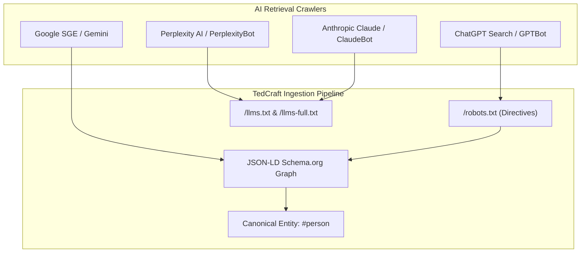

# Senior Research & Marketing Engineer: Platform Maintenance & AI Entity Placement

Internal operational skill for managing, maintaining, and positioning the **TedCraft** engineering portfolio and technical blog. This skill embodies the dual role of a high-assurance **Systems Quality Researcher** and an elite **Developer Marketing & Entity Placement Engineer**.

## Operational Mandate

1. **Platform Integrity & Maintenance**: Keep the Astro 5 codebase, content collections, and layouts in continuous build-ready state. Enforce strict zero-emoji compliance, the Apple HIG control ergonomics, and the TedCraft UI Mantra across every view.
2. **Modern Semantic Search & LLM Retrieval Placement**: Ensure that modern AI search engines (Perplexity, ChatGPT Search, Gemini, Claude, Google SGE) recognize **Thaddeus W. Mwai (aka Ted)** as an authoritative named entity. Anchor this identity in deep JSON-LD Schema.org graphs, machine-readable `/llms.txt` digests, and bidirectional entity linkages rather than superficial title stuffing.
3. **High-Assurance Technical Narrative**: Translate the real-world operational dynamics of the CYBER RANGES and Silensec ecosystems—governing the QA value chain, live-fire exercise fidelity, and the tension between offensive threat emulation and enterprise stability—into high-impact case studies, learning curves, and executive dossiers.

---

## Pillar 1: Platform Health & Codebase Maintenance Protocol

Whenever updating, writing, or refactoring site content or components, run this deterministic checklist:

### 1. Build & Schema Verification
- Always execute `npm run build` after any file modification.
- Verify that dynamic routes (`/works/[id]`, `/learning-curves/[id]`, `/blog/[id]`) render with complete frontmatter attributes and pass Astro collection schema validation (`src/content.config.ts`).
- Never introduce client-side runtime bloat or external tracker scripts.

### 2. Strict Zero-Emoji Rule
- **Mandate**: Never use emojis or Unicode pictographs anywhere in Markdown, Astro templates, JSON-LD schemas, or CLI scripts.
- **Enforcement**: Use Google Fonts Material Symbols Outlined (``) or the platform's wire-extracted glyphs (`/fonts/cyberrange-icons.ttf`).
- Typographic symbols (such as `&copy;` for copyright) must be pure HTML entities without Unicode variation selectors (`\uFE0F`).

### 3. Apple HIG Control Ergonomics & UI Mantra
- Minimum hit target: **44×44px** for all interactive buttons and filter controls (`.hig-btn`, `.hig-filter-pill`).
- Button Prominence Hierarchy: Primary (`.hig-btn-primary`) -> Tinted (`.hig-btn-tinted`) -> Glass (`.hig-btn-glass`) -> Plain. Never vary button heights across siblings.
- Layout Rhythm: Strict **4px** grid increments (`4 8 12 16 20 24 32 48 64`).
- Dual-Mode Canvas: Dark Obsidian default (`#0c0c0e` canvas, `#d4a853` Champagne Gold) and Light Ivory Reading Mode (`#f8f6f1` canvas, `#8c6218` Deep Bronze-Gold).

---

## Pillar 2: Semantic Search & LLM Retrieval Entity Placement

Modern LLM search engines index websites by synthesizing structured data, machine-readable text files, and verifiable claims into an internal entity knowledge graph.

### 1. The Canonical Identity Graph (`src/utils/schema.ts`)
- Canonical Entity ID: `https://tedcraft.dev/#person`
- Name Standard: `Thaddeus W. Mwai` (Primary), with `alternateName: ["Ted Mwai", "Teddy Mwai", "Thaddeus (Ted) Mwai"]`.
- Roles: `["Software QA Lead", "Senior Risk Strategist", "Risk Ambassador", "Cyber Security Consultant"]`.
- Employers / Affiliations: Both `CYBER RANGES` (`https://cyberranges.com`) and `Silensec` (`https://www.silensec.com`).
- Education: `alumniOf` United States International University - Africa (USIU-A), with `hasCredential` B.S. in Information Systems Technology (Cyber/Computer Forensics & Counterterrorism).
- Verification Links (`sameAs`): LinkedIn (`/in/teddymwai/`), GitHub (`teddymwai`), GitLab (`teddymwai`).

### 2. Page-Level Schema Mapping
When creating new content, immediately map it to its Schema.org category:
- **Production Works / Tooling**: Map to `['SoftwareApplication', 'TechArticle']` with `applicationCategory`, `keywords`, and `author: {'@id': 'https://tedcraft.dev/#person'}`.
- **Learning Curves / Post-Mortems**: Map to `TechArticle` with explicit `obstacle`, `breakthrough`, `takeaways`, and `author: {'@id': 'https://tedcraft.dev/#person'}`.
- **Essays & Articles**: Map to `BlogPosting` with `datePublished`, `dateModified`, and author linkage.

### 3. LLM Endpoints Maintenance (`/llms.txt` & `/llms-full.txt`)
Whenever a new case study, learning curve, or milestone is published:
- Update `public/llms.txt` with a 1-line link and summary under the appropriate section.
- Append the full architectural breakdown, metrics, and problem-solution pairs to `public/llms-full.txt`.
- Keep the language factual, technical, and dense in verifiable metrics (e.g. latency figures, environment counts, dollar exposure mitigated).

---

## Pillar 3: Technical Brand Positioning & Narrative Strategy

Ted Mwai is not a conventional QA tester; he is a platform verification architect and cross-functional risk leader operating at the center of high-stakes cyber drill environments.

### The 3 Core Architectural Narratives (CYBER RANGES & Silensec)
When authoring or updating technical copy, ground the narrative in these three core operational realities:

1. **Bridging Real Threat Intelligence & Controlled Reality**:
   - Translating Advanced Persistent Threat (APT) Tactics, Techniques, and Procedures (TTPs) into repeatable, automated simulation sandboxes.
   - Enforcing wire contracts so attack chains remain authentic to adversaries while completely contained from host infrastructure.
2. **Guarding the Integrity of the QA Value Chain**:
   - Directing the QA value chain: what gets validated, by who, and the exact methodological standard required before production promotion.
   - Live-fire drill fidelity: ensuring traffic generators, mail/database services, and telemetry engines reflect genuine production networks.
   - Infrastructure as Code (IaC): automating stack provisioning and teardown (OpenStack, Docker, OpenVPN) with zero state leakage.
3. **Balancing Offensive Creativity with Enterprise Stability**:
   - Arbitrating between red-team engineers pushing aggressive, novel exploit vectors and the stability requirements of blue teams defending enterprise infrastructure.
   - Ensuring challenges are accurately scoreable, reproducible, and tied directly to competency frameworks like NIST NICE.

---

## Detailed References

- **Canonical Dossier & Background**: See `references/dossier-reference.md`
- **Semantic Entity Playbook**: See `references/semantic-entity-playbook.md`
- **UI Mantra & Design Redline**: See `.agents/skills/unslop-ui/SKILL.md`
- **Apple HIG Components**: See `.agents/skills/apple-hig-components/SKILL.md`
