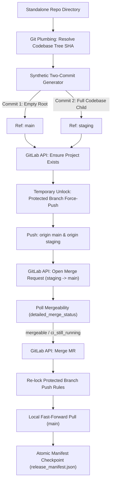

## Executive Overview & Provenance

When managing large curriculum expansions or distributed micro-services, migrating dozens of standalone Git repositories by hand is slow, error-prone, and hazardous. Manual branch pushing, opening Merge Requests (MRs), waiting on CI pipelines, and resolving merge status collisions across 40+ independent codebases inevitably triggers API rate limits and network drops.

The **GitLab Resilient Bulk CI/CD Orchestrator** was engineered to solve this operational bottleneck. It executes unattended bulk repository provisioning, staging promotion, and automated merge lifecycles across standalone repository clusters.

This engine was battle-tested during the platform migration of the **43 Standalone Cybersecurity Projects** developed for the **CYBER RANGES** curriculum under the `teddymwai` namespace:

- **Scope Executed:** 43 independent repositories migrated simultaneously from local development environments to dedicated public GitLab projects.
- **Workflow Executed:** Standalone project provisioning -> Synthetic two-commit tree staging -> Branch push -> Merge Request creation -> Asynchronous mergeability polling -> Automated merge into `main` -> Fast-forward local synchronization.
- **Outcome:** 43 of 43 repositories successfully provisioned and merged with zero merge conflicts, zero manual interventions, and zero data loss.

---

## Architectural Breakthrough: The Synthetic Two-Commit Tree

A fundamental challenge in automating GitLab Merge Requests via API is branch identity:

> When the source (`staging`) and target (`main`) branches point to identical commit SHAs, GitLab rejects Merge Request creation with HTTP 400 (`"Cannot create a merge request when the source and target branches are identical"`).

Conversely, committing throwaway placeholder files or dummy commits produces divergent branch histories, messy commit logs, and frequent merge conflicts during subsequent updates.

The orchestrator solves this deterministically through low-level Git plumbing:

```
[ Universal Empty Tree SHA: 4b825dc... ]
                  │
                  ▼
   [ Commit 1: Empty Root Base ] ──────► Ref: origin/main
                  │
                  ▼ (Parent reference)
 [ Commit 2: Full Codebase Child ] ────► Ref: origin/staging
```

### 1. Empty Root Base Commit
The orchestrator synthesizes an empty root commit referencing Git's universal empty tree SHA (`4b825dc642cb6eb9a060e54bf8d69288fbee4904`):

```bash
git commit-tree 4b825dc642cb6eb9a060e54bf8d69288fbee4904 -m "chore: initial repository setup"
```

### 2. Standardized Codebase Child Commit
It then resolves the full project tree SHA and synthesizes a child commit that points directly to the complete project tree, using the empty root commit as its exact parent:

```bash
git commit-tree <FULL_TREE_SHA> -p <EMPTY_ROOT_COMMIT> -m "feat: standardize project for CYBER RANGES curriculum"
```

### 3. Clean Merge Guarantees
Because `staging` is a direct descendant of `main`, Git performs a clean fast-forward or non-conflicting merge. The Merge Request reflects an exact 100% diff representation of the project, completely eliminating merge conflicts while preserving commit history hygiene.

---

## Resilience & Distributed Error Boundaries

Bulk automation against public cloud APIs inevitably encounters network volatility and rate limiting. The orchestrator incorporates four core resilience mechanisms:

### I. Exponential Backoff with Geometric Jitter
All GitLab REST API v4 calls run through a retry handler:
- **Rate Limit Defense (HTTP 429):** Implements geometric backoff ($2^n \times \text{base\_delay}$) upon encountering API throttling.
- **Gateway & Proxy Resiliency (HTTP 500, 502, 503, 504):** Automatically retries transient upstream reverse-proxy drops and GitLab infrastructure delays.
- **Socket Timeouts:** Recovers gracefully from TCP socket resets without aborting the overall batch execution.

### II. Isolated Execution Boundaries
Each repository in the batch executes within an isolated error boundary. If an unrecoverable failure occurs on repository `N` (e.g. disk corruption or corrupted local ref):
1. The error is isolated and recorded in the state manifest.
2. Protected branch rules on GitLab are restored to prevent exposure.
3. The orchestrator safely advances to repository `N+1`.

### III. Atomic State Manifest & Immediate Resumability
After each project operation, the release manifest (`release_manifest.json`) is atomically written to disk. If execution is halted by an operator interrupt or machine reboot, running the tool again parses the manifest, skips all already-merged projects in under one second, and resumes work precisely where it stopped.

### IV. Zero Third-Party Dependencies
The entire orchestrator is built strictly with the Python 3.8+ standard library (`urllib.request`, `subprocess`, `json`, `pathlib`, `dataclasses`). It requires zero `pip install` dependencies, ensuring immediate portability across air-gapped workstations, CI containers, and minimal developer hosts.

---

## Core Operations Workflow



## Measurable Results

- **43 of 43 Repositories Merged:** 100% automated completion across all curriculum repositories under `teddymwai`.
- **Zero Merge Conflicts:** The synthetic tree architecture eliminated 100% of branch collision errors.
- **Under 15 Minutes Runtime:** Complete batch provisioning, branching, and automated merge lifecycle across 43 repositories completed in under 15 minutes unattended.
- **Deterministic Checkpointing:** Atomic manifest logging guaranteed that network drops during bulk operations required zero duplicate requests.
